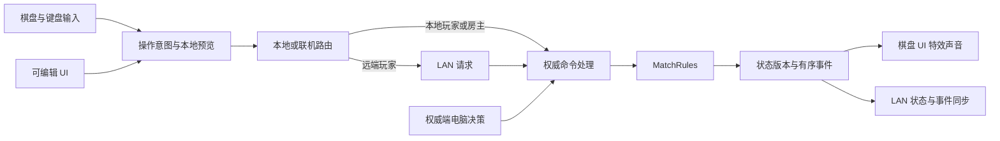

# Driftline 改进计划 v2

日期：2026-10-14。状态：用户已批准实施，A–F 已完成首版实现，G 的工程验证已完成，真实 LAN 与人工体验验收待试玩。实际完成范围与证据见 [实施状态](IMPLEMENTATION_STATUS.md)。以下原检查记录保留为实施前基线。本版替代旧计划。

## 1. 范围与结论

**可编辑 UI、棋盘直接点按、单人模式与电脑玩家、局域网联机，均属于必需交付。**原有场景构成、背景故事、特效与声音改进继续保留，与这些系统一起设计。

推荐先交付“可手动编辑的 UI + 完整棋盘点按”，随后完成电脑对手和真实局域网对局，再收束场景、故事与特效。基本规则继续以 `MatchRules` 为准，交互改造不能悄悄改变滑行、选子或道具规则。

规划检查时没有修改游戏代码、场景、游戏资产或包配置，也没有进入 Play Mode、测试或构建。之后用户已授权实施，实际代码、场景、测试与构建结果见实施状态。全部工作使用 Windows PowerShell 和 `http://127.0.0.1:8080/mcp`，没有使用 WSL。

## 2. 撤回后的当前事实

| 部分 | 本轮确认的状态 | 对改造的影响 |
| --- | --- | --- |
| Unity / 场景 | `2022.3.62f3`；MCP 实例 Driftline；未修改的 Edit Mode `SampleScene` | 以当前文件与实时场景为基线 |
| 场景构成 | 已回到木桌、浅色格子、积木式墙体与桌面玩具；没有上一轮地牢柱体根节点 | 从桌面版重新设计，旧运行截图不代表现在的画面 |
| UI 静态资产 | 场景已有 `Draftline UI` + `UIDocument`，引用 `DraftlineHUD.uxml` 与 PanelSettings；Canvas 数为 0 | 当前有 UI Builder 通道，但没有逐项 GameObject 编辑方式 |
| UI 动态内容 | `Refresh/BuildActions` 清空再生成动作、玩家行和记录；急停生成坐标按钮 | 只把 UIDocument 摆入场景不足以解决编辑空间，正式控件与模板应持久化 |
| 棋盘选子 | 鼠标只在 `WaitSelect` 射线选子，以 `screen.x < 360f` 排除左面板 | 有部分入口，但缺完整的点击、预览和取消流程 |
| 移动 / 急停 | 移动依赖方向键/侧栏按钮；急停依赖侧栏坐标列表；终点圆片移除 Collider | 终点目前主要是显示标记，不能点目标直接完成操作 |
| 联机输入 | UI 的选子/移动方法会转发；鼠标直接调用 `rules.TrySelectPiece`，方向键直接调用 `SubmitDirection` | 从代码确认棋盘/键盘入口绕过 LAN 命令路由，需要统一 |
| 单人 AI | 未找到电脑决策器和人类/电脑席位配置 | 需要完整的电脑回合驱动，不只是菜单按钮 |
| LAN 基础 | NGO `1.15.1`、Transport `1.5.0`，已有主机权威命令与快照，默认端口 `7777`；入口在 UXML 中隐藏 | 沿用基础，补齐房间和生命周期，不能视为已完成联机模式 |
| 网络表现 | 状态包传快照和一条滑行，未传完整事件列表；客户端先应用快照再播放滑行 | 需要完整事件序列与表现队列，避免状态/演出不一致 |
| 状态复制 | `FromSnapshot` 直接加入 Piece/FieldItem 对象引用；快照没有 `DeadAtTurnStart` 与 RNG 状态 | 不可直接作为 AI 独立推演的深复制 |
| Console | 返回 VS UDP 警告、DOTween 已销毁 Transform 与 Safe Mode 警告，未返回 Error 日志项 | 后续检查动画取消、对象销毁与再开局；本轮未复现触发步骤 |
| 测试 | 有 20 个现有规则测试，本轮只阅读 | 不能宣称本轮已通过规则、联机或完整体验验收 |

最近提交 `f5748634c` 的说明是回滚到桌面版、修复棋子点击、UI 摆进场景。以当前实现核实结果为准，不仅凭提交说明判断功能完成。


## 3. 共同基础：模式、席位与统一命令

### 三种模式都要完整

每个颜色绑定一个席位，配置 `Closed / LocalHuman / RemoteHuman / Computer`，记录名称、准备状态、AI 难度。席位身份与网络 ClientId 分开，重连或电脑接管不改变棋子归属。

| 模式 | 首版行为 |
| --- | --- |
| 单人 | 1 名本地玩家 + 1–3 名电脑，支持 1v1 / 1v2 / 1v3，可选择人类颜色 |
| 同机多人 | 保留 2–4 名本地玩家轮流操作，席位模型也可支持混合电脑 |
| 局域网 | 房主 + 远端人类，2–4 个有效席位；房主可把空位设为电脑，AI 只由房主运行 |

### 同一套权威规则处理



按实际需要逐步拆分现有控制器，以下命名为实现提案：

- `MatchSession`：模式、席位、控制权、开局/结束/重开。
- `MatchCommandDispatcher`：提交掷骰、出子、滑行、道具等意图；校验控制权、阶段与状态版本，返回结果和失败原因。
- `BoardInteractionController`：统一指针命中、预选、路径与取消，不直接修改规则。
- `MatchPresenter` 与事件队列：更新棋子、墙、UI、声音，同一事件只播放一次。
- `ComputerPlayer`：读状态、推演、提交命令，不模拟按钮或鼠标。
- `LanSession`：沿用 `DraftlineLanRoom` 的通信，完善房间与请求/结果协议。

规则保留在 `Draftline.Core`，AI 可放在尽量不依赖 Unity 的程序集。所有棋盘、快捷键、UI 与 AI 输入都走统一入口；客户端只预览和发请求，主机/本地会话才能正式提交。

## 4. UI：提供实际可编辑的空间与渠道

### 推荐 uGUI Canvas + 保存的 Prefab

正式游戏 UI 推荐迁移为 **uGUI Canvas、持久 Prefab、Inspector 引用**。这直接对应在 Hierarchy、Scene/Game View、Prefab Mode 中调整每个控件的需求，也适合棋子附近的上下文提示。Unity 2022.3 官方比较列出了 uGUI 的 GameObject/Component 工作流及运行时用途。[Unity UI 系统比较](https://docs.unity3d.com/2022.3/Documentation/Manual/UI-system-compare.html)

UI Toolkit 本身可以通过 UI Builder 编辑 UXML/USS。本次推荐迁移针对用户的工作流；并非所有运行时 UI Toolkit 都无法编辑。当前 UXML、USS 与文案作为迁移参考，每个阶段只启用一套正式输入 UI。

建议持久保存以下结构，名称与目录均为待实施方案：

```text
UIRoot (Canvas + CanvasScaler + GraphicRaycaster)
  MainMenuPanel
  MatchSetupPanel
    ModeSelector
    SeatRed / SeatBlue / SeatGreen / SeatYellow
  LanLobbyPanel
    ConnectionPanel / Seats / Ready / Start
  MatchHUD
    TurnInfo / DiceInfo / PlayerStates / Inventory / EventLog
  PauseAndSettingsPanel
  ResultPanel
  TooltipLayer
EventSystem (InputSystemUIInputModule)
BoardInteractionRoot
  SelectionMarker / DirectionMarkers / StopMarkers / ContextActions
```

拟交付 `Assets/UI/Prefabs/UIRoot.prefab` 与独立页面、玩家行、道具槽、日志项 Prefab；`Assets/UI/Config` 保存样式、文案与默认席位配置；`Assets/Prefabs/BoardInteraction` 保存棋盘提示模板。

4 个席位、4 行玩家状态、2 个当前玩家道具槽可预先摆好再按状态显隐。数量可变的日志或路径提示允许复用/实例化**已经保存且可编辑的模板**，不在代码中重新拼接完整控件树与视觉样式。

### 用户编辑与运行时绑定的职责

| 修改内容 | 用户编辑渠道 | 运行时代码职责 |
| --- | --- | --- |
| 页面位置、宽高、锚点、间距、层级 | Hierarchy、RectTransform、Layout 组件、Prefab Mode | 不用硬编码值覆盖编辑结果 |
| 背景、按钮、图标、边框、字体与字号 | 控件 Inspector、模板与共享样式资产 | 更新必要的状态外观，不重建整页 |
| 标题、提示、故事与错误说明 | 序列化字段或文案配置 | 填入名称、数量等动态数据 |
| 玩家行、道具槽、日志项 | 对应 Prefab | 数据更新、显隐与实例复用 |
| 选中圈、箭头、路径、急停标记 | 棋盘交互 Prefab / 配置 | 按真实规则放置，视觉取资产配置 |
| 页面跳转与操作 | Inspector 引用、视图/Presenter 绑定 | 调用统一命令，不计算规则 |

正式场景直接挂齐 UI、会话、交互和网络组件，使用序列化引用。缺配置给出明确错误，不在 `Awake` 临时补整套系统，让 Edit Mode 与真正运行结构相符。

交付 `Docs/UI_EDITING_GUIDE.md`，列出每页、每种模板与文案的准确编辑位置。可提供样例预览器切换开局/房间/对局/结算；只显示样例，不执行真实对局或覆盖保存的布局。

### 页面设计

- 主菜单：单人游戏、同机多人、局域网、设置。
- 配置页：4 个席位卡，设置人类/电脑/关闭、颜色与难度；单人必须有一个人类和至少一个电脑。
- 房间页：地址、端口、连接状态、席位、准备、房主开局。
- 对局 HUD：当前玩家、骰子与剩余滑行、库存、胜利目标、必要记录。棋子选择列表与坐标停点列表退出主要操作流程。
- 结算：实际获胜原因、再来一局、返回菜单；LAN 再开局由房主同步，不自动变为本地对局。
- 设置：音量、演出简化/震动、退出入口；适配 1920×1080、1366×768、1280×720 与窗口缩放。

**完成标准：**停止 Play Mode 后仍能看见并编辑正式页面和模板。手动修改按钮位置、字体、背景与说明，重启和运行后修改仍保留。只增加 UIDocument 或“生成 UI”按钮不能算完成。

## 5. 棋盘点按：完整鼠标操作流程

| 操作 | 棋盘上的方式 | 反馈与约束 |
| --- | --- | --- |
| 掷骰 | 点桌面骰子，保留现有入口 | 仅当前人类可操作；投掷中防重复，电脑调用同一权威流程 |
| 出子 | 点亮的出生格或该格“+”标记 | 预览储备与落点，不可出子时说明原因 |
| 选棋子 | 点可操作的己方棋子 | 悬停/选中圈、路径与终点；敌方可查看不能控制 |
| 普通滑行 | 点对应方向的终点标记或棋子旁的棋盘箭头 | 悬停展示完整路径；普通滑行不能停在任意中间格 |
| 道具 | 点棋子旁的上下文图标，或 HUD 两格库存 | 说明效果，预览改变后的路径，不跳到操作列表 |
| 急停 | 启用急停后，点路径上的可停格 | 显示真正停点与传送结果，不要求读坐标和计算 |
| 取消预览 | 右键 / Esc，必要时点空白 | 只清临时选择，不扣行动；已提交动作不自动撤销 |
| 查看危险 | 悬停危险标记或棋子 | 展示四连、墙切换的威胁与原因 |

### 预选与权威提交分开

当前 `TrySelectPiece` 只允许 `WaitSelect`，执行后进入 `Moving`，余下滑行默认使用同一棋子。计划保持这个规则：

1. 首次滑行前，点击只建立**本地预选**，可以改选和查看方向/道具，权威状态不改变。
2. 点合法目标后提交 `pieceId + direction + stopIndex? + optionalItem`。权威端在独立副本依次校验选择、可选道具和滑行，全部合法才一次性提交；失败不部分扣道具或次数。
3. 首次滑行后默认锁定本回合棋子，后续提交下一次滑行/道具。不擅自允许把骰子次数分给多枚棋子。
4. 已独立提交并消耗的道具不因取消路径返还；取消方向/停点预览只清本地交互。

### 路径与命中实现

- 保留 `BoardCoordinates` 格子映射，指针集中分发，结束控制器、玩具、涟漪分别处理同一次点击的方式。
- 预览来自 `MatchRules.PlanSlide`：真实路径、传送、拾取、撞吃、破墙，不另写移动规则。
- 普通移动仅终点可提交；急停按当前 `TrySlide` 接受的 Steps 索引显示停点。传送前后分段画路径，不跨整盘画一条虚假直线。
- 每个目标绑定 `pieceId / direction / stepIndex / expectedRevision`，不能仅用目标坐标反推方向。不同方向经传送到同格时，用棋子旁方向箭头或目标附近的小选择器区分，操作仍在棋盘上。
- 对 PortalEntry/PortalExit 等特殊步骤，先明确当前规则的合法停点语义再做提示，不擅自删除或增加停点。
- 专用交互 Layer/Collider 或棋盘平面投影负责命中；装饰、墙侧和粒子不能抢走目标。命中面积可大于视觉点，便于点小格。
- 按实际 UI 命中、弹窗、当前控制权、动画与未确认请求阻挡正式提交，取消过期目标。
- 键盘作为可选快捷方式，调用同一命令路由；单人、同机、LAN 使用同一套棋盘交互。

**完成标准：**隐藏旧动作列表，只用鼠标完成掷骰、出子、预选/改选、点终点滑行、道具、点急停格与交接。经传送门也无需读坐标或自行计算方向。

## 6. 单人模式与电脑玩家

### 控制完整回合

电脑按席位与阶段工作：等待权威掷骰结果；判断是否出子与选哪枚棋子；决定每次滑行、道具和急停点；持续到回合结束、无合法动作或胜利。显示“电脑思考中”，玩家可看棋盘与设置，但不能操作电脑席位。

电脑通过会话命令执行实际动作，并播放正常表现。不调用 UI 按钮、不模拟鼠标、不移动 Transform、不直接写正式状态。LAN 只在房主运行 AI。

### 第一期决策

采用**合法动作枚举、评分、有预算的回合内搜索**：

1. 枚举出子/不出子、可选棋子、方向、道具及合法急停索引。
2. 对同一棋子的剩余 1–6 次滑行做有限宽度搜索，实际运行规则到相应状态，包含回合末墙切换和围杀。
3. 优先实际胜利，再考虑阻止对手近期胜利、保护危险棋块、围杀、成线潜力、行动空间、库存与道具收益。
4. 分别估计多个对手，不把四人局硬套成只对付一名对手的二人 minimax。
5. 无意义来回软扣分，不禁止合法往返；预算用完返回最佳合法候选。
6. 状态变更后重新校验计划，不继续执行失效路径。

首版“简单/普通”：简单在较好的合法候选间加入适量随机；普通用更充分的搜索和危险判断。高难度后续增加，不以违规或选择骰子结果提升难度。

先以约 200–500ms 思考预算作为调优目标，按帧分摊或仅在独立数据副本上搜索，不冻结主线程。展示等待可配置。该数字是目标，不是本轮测量结果。

### 独立推演能力是前提

新增专用 `CloneForSimulation` / `RuleSnapshot`：深复制棋子、道具、玩家库存、阶段、所选棋子、回合起始零气集合、随机数状态及结算字段。当前 `FromSnapshot` 不能直接当深复制使用。

实际骰子由权威端产生，AI 不挑点数。未来道具随机生成用隔离 RNG 副本或多个采样；推演不得推进正式 RNG。展示快照和完整推演状态的职责分清。

必要验证：推演不改变正式棋盘/库存/RNG；完整状态与相同随机状态可复现结果；处理传送、四道具、无路、淘汰与胜利；不重复提交；退出/断线/重开后取消旧决策。

**完成标准：**1v1/1v2/1v3 可从开局到结算与再开局，电脑自动完成所有阶段。策略强度与趣味性仍需实际玩家判断，合法完整不等于已经足够聪明。

## 7. 局域网联机：补成完整模式

### 房间与席位

1. 创建/加入入口公开可用。房主显示实际 LAN IPv4 和可配置端口；127.0.0.1 仅用于同机测试。
2. 首版保证手动 IP 连接，自动发现后置。
3. 房主配置 2–4 个有效席位，可电脑补位；人类选择可用席位/颜色并准备，房主统一开局。
4. 连接核对协议与规则/棋盘版本；所有端收到相同人数、颜色、角色、主题与配置。
5. 连接超时、房间满、版本不匹配、断线与取消有明确状态；支持退出、再加入、返回房间和再开局。

### 主机权威与同步

- 沿用 NGO + Unity Transport 的自定义消息基础。棋盘同步离散逻辑状态，不必给每枚棋子增加 NetworkTransform 物理同步。
- 请求带 `sessionId / matchId / commandId / expectedRevision`；主机按真实连接对应席位核对控制权、回合、阶段与参数。
- 返回接受/拒绝及原因。接受后下发状态版本与完整有序事件；重复请求不能重复扣次数/库存，拒绝解除客户端等待。
- 客户端本地显示预选、悬停和路径；实际行动等待确认，状态更新取消过期目标。
- 开局/恢复用完整快照；正常操作可沿用小棋盘完整状态加事件，先保证正确性，再考虑差量压缩。
- 事件覆盖滑行原点/路径、出子、拾取/使用、撞吃/围杀、墙切换、淘汰、换人和胜利。状态是最终事实，队列按事件展示过程，避免先瞬移到终点再演一遍移动。
- 事件序号保证只播放一次；加入/恢复按快照恢复，不重播历史。
- 物理骰仅主机产生结果，客户端播放统一开始/结果演出，不自行掷出影响规则的点数。AI 走同一流程。
- 整理消息处理器注册/注销、连接与对局序号、新旧房间消息隔离。

### 断线与重开

- 远端掉线保留席位与棋子，暂停需要该玩家的后续提交并提示，不永久等待。
- 约定窗口内允许原席位重连，使用会话内重连标识恢复身份，下发房间与棋盘快照。
- 超时后房主选择电脑接管或结束对局；不能仅删除连接记录而留下无法行动的颜色。
- 房主退出后客户端返回可操作菜单并说明原因；首版不实现房主迁移。
- 房主再开局创建新 matchId、统一重置；客户端确认配置/准备后进入新局，不自动切到本地对局。

**完成标准：**至少两台真实 Windows 设备完成人类和人类+电脑混合对局。鼠标选子、终点点击、急停、道具、墙切换与胜利一致；离开、重连、接管和再开局可操作。同机多进程测试不能替代真实 LAN 验收。

## 8. 场景、故事、特效与 UI 一起设计

先以当前桌面版稳定功能，再做完整主题棋盘。上一版“失序遗迹的机关棋庭”保留为**待定故事方向**：四支探索队以十枚符文傀儡争夺界钥，五连形成共鸣，围杀解除投射，最后存活者也可夺得界钥。可做桌面微缩遗迹；是否转为完整大厅，在主题规格阶段定稿。

| 工作 | 交付 | 与新功能的关系 |
| --- | --- | --- |
| 背景故事 | 一页设定、四方动机、可跳过开局短文、两种结局 | 席位卡/结算使用相同身份和徽记，不引入职业能力差异 |
| 场景构成 | 主棋盘、四角、外围场所/桌面摆设、低频氛围 | 适合点击与镜头构图，摆件不挡棋子/目标 |
| 功能物件 | 固定墙、阵营门、机关槽、传送门、棋子与道具 | 颜色+形状+配对符号直接读图，装饰和交互标记分明 |
| 选择预览 | 悬停圈、选中圈、分段路径、箭头、终点与停点 | 从用户可编辑的 Prefab 生成，数据来自规则 |
| 事件演出 | 出子、滑行、传送、墙升降、四道具、围杀、两类胜利 | 人类、电脑、主机与客户端共用表现表与事件队列 |
| 音效环境 | 事件声、低频环境声、轻音乐、音量/简化设置 | 提示有层级，电脑连续行动不会因演出拖沓 |

先完成清楚的墙体轮廓、传送配对与危险信息，再加亮光/粒子。使用连续低墙与少量重点立柱，统一模型朝向和比例。默认全盘与俯视都能看清四角，HUD 大小变化时构图仍成立。

“剩余滑行、急停、穿墙”等规则词保持明确，故事名辅助理解，不新增另一套资源概念。围杀/零气叙事必须符合结算和自吃限制，不能简单写成“所有零气棋子立即死亡”。

## 9. 资产策略

| 现有资产 | 用途 |
| --- | --- |
| KayKit Dungeon Remastered | 墙、地板、旗帜、柱、火把、箱桶与道具；按主题选局部样件审阅 |
| Polyworks Dungeon / Boardgame、Low Poly Ultimate Pack | 桌面或外围的实际缺件，先统一比例/材质，不混成资产陈列 |
| Dice_6 与现有 Dice Rig | 保留模型与映射，统一点击/权威投掷 |
| DOTween、Feel、Cinemachine、Cartoon FX | 复用表现依赖，统一时序风格并处理销毁/取消 |
| Resources/Sfx、Casual Game Sounds U6 | 先试听与整理，再补声音 |

公开候选为 [Kenney Board Game Icons](https://kenney.nl/assets/board-game-icons)、[Input Prompts](https://kenney.nl/assets/input-prompts)、[Interface Sounds](https://kenney.nl/assets/interface-sounds)、[KayKit Dungeon Pack](https://kaylousberg.itch.io/kaykit-dungeon-pack)。上一轮已核查官方页面 CC0 信息，本轮未新增下载/导入。实施时按实际免费档位与随包说明记录来源。

UI 无需购买新插件，LAN 沿用现有网络包，AI 用规则决策实现。中文字体需检查独立 Windows 构建的实际覆盖，不能仅凭编辑器系统字体回退判断。

## 10. 实施顺序与里程碑

| 阶段 | 交付 | 依赖与完成标准 |
| --- | --- | --- |
| A：规格与共同基础 | 模式/席位、命令契约、完整深复制、预选/取消规格、UI 编辑契约；同步定故事/视觉规格 | 保留规则，输入与模式不会产生不同规则路径 |
| B：可编辑 UI | Canvas、页面与模板 Prefab、Inspector 引用、样例预览、编辑指南 | A；不运行游戏也能编辑完整页面，运行不覆盖修改 |
| C：棋盘直接操作 | 选子/改选、出子、点击终点、道具、急停、统一命中与阻挡 | A+B；隐藏旧操作列表，鼠标完成含传送/急停的回合 |
| D：单人电脑 | 单人配置、简单/普通 AI、回合驱动、提示与取消 | A+C；1v1/1v2/1v3 从开局到再开局，推演不影响真实状态 |
| E：完整 LAN | 创建/加入、席位/准备/电脑补位、确认与同步、断线/重连/接管/重开 | A–D；两台设备对局一致，操作不退回菜单按钮 |
| F：完整主题与演出 | 一张主题棋盘、场景构成、故事与阵营卡、特效声音设置 | A 的主题规格、B/C 布局、E 事件契约；三种模式呈现同一体验 |
| G：集成验收 | 规则回归、编辑持久性、完整单人/同机/LAN、分辨率、Windows 构建 | 分别报告工程结果与人工体验，不混为通过 |

**首个里程碑 A–C：**你能编辑正式 UI，玩家能在棋盘上直观完成操作。第二个是可独立玩的单人版本，第三个是实际可用 LAN，最后统一美术/故事/表现。

场景风格草案前期同步整理，不让美术阻塞功能接口。单人和 LAN 不再后置为另行评估。更多主题/棋盘、高难度 AI、自动发现、公网服务与房主迁移可后置。

## 11. 必要验证与工程基线

| 对象 | 必要验证 |
| --- | --- |
| UI | 停止运行后改布局/文案/字体，重启和运行仍保留；所有正式页面有准确编辑入口 |
| 点按 | 非己方、非法方向、重复点击、UI 遮挡、分辨率、切镜头、重合目标、门前/门后急停、取消、过期目标 |
| 规则/命令 | 20 个现有测试；原子失败无副作用、重复/过期请求、复制隔离与 RNG 不被搜索消耗 |
| AI | 各人数/阵营、四道具、出生点占用、无路、淘汰、成线、长局往返、退出/重开取消旧任务 |
| LAN | 两台设备，2/3/4 方和电脑混合；控制权、掉线/恢复/接管、房主退出、重开与事件一致 |
| 生命周期 | 动画中退菜单、胜利后再开局、取消 Tween、销毁对象；看门狗不作为正常完成流程 |
| 体验 | 默认/俯视读图、中文、缩放、声音重复感、电脑等待、完整对局是否直观 |

本轮仍确认依赖声明和编辑器注册不同：manifest/lock 声明 URP `17.3.0`、UGUI `2.0.0`，实际注册 URP `14.0.12`、UGUI `1.0.0`。实施前核对 2022.3 的依赖解析和可重建基线，先查原因再改配置；无需以引擎升级作为这些功能的前提。[URP 官方兼容说明](https://docs.unity3d.com/Packages/com.unity.render-pipelines.universal@14.0/manual/requirements.html)

胜利相机重置、物理骰投掷失败恢复、UI 缺引用、处理器注册时机与 DOTween 销毁警告列入对应阶段。本轮只读核查，不宣称这些已修复或复现。后续只增加有意义的规则/协议/复制检查，视觉小改通过人工审阅验证。

## 12. 现有代码的改造落点

| 入口 | 重点 |
| --- | --- |
| `Assets/Scripts/Draftline/Unity/DraftlineGameUI.cs` | 从拼接控件改为保存的视图/Presenter，布局/文案可编辑 |
| `Assets/Resources/UI/DraftlineHUD.uxml`、`DraftlineTheme.uss` | 迁移页面/文案/视觉参考，旧输入关闭后再清理 |
| `Assets/Scripts/Draftline/Unity/DraftlineGameController.cs` | 拆会话/命令/输入/表现，统一 LAN 路由与取消/重开 |
| `BoardCoordinates.cs`、`DraftlinePieceView.cs`、`DraftlineItemView.cs` | 目标 ID/格子映射、交互命中、说明与视觉 Prefab |
| `DraftlineTabletopInteraction.cs`、`DraftlineBoardAmbience.cs`、`DraftlineRollDice.cs` | 指针分发与 UI 阻挡，一次点击仅处理一次 |
| `Assets/Scripts/Draftline/Core/MatchRules.cs`、`MatchState.cs` | 原子校验、合法动作、深复制与随机状态，保留基本规则 |
| `Assets/Scripts/Draftline/Unity/MatchSnapshot.cs` | 展示/推演职责、版本与完整事件协议 |
| `Assets/Scripts/Draftline/Unity/DraftlineLanRoom.cs` | 房间/席位/准备/AI、确认/事件、断线重连与重开 |
| `DraftlineCameraDirector.cs`、`DraftlineWarnings.cs`、`DraftlineAudio.cs` | 读图、统一表现、设置、胜利重置与清理 |
| `Assets/Editor/DraftlineSceneBake.cs`、`DraftlineDungeonSkin.cs` | 制作工具不覆盖手动 UI/美术编辑，明确绑定契约 |
| `Assets/Tests/EditMode/BoardAndRulesTests.cs`、`Assets/Editor/DraftlineBuild.cs` | 回归与独立 Windows 构建验证 |

实施按 A 的命令契约、B–C 的编辑 UI 与点按、D 的电脑、E 的网络、F 的主题顺序推进。新增类、目录与 Prefab 已落地，完成范围、实际验证与剩余人工验收以 [实施状态](IMPLEMENTATION_STATUS.md) 为准。
